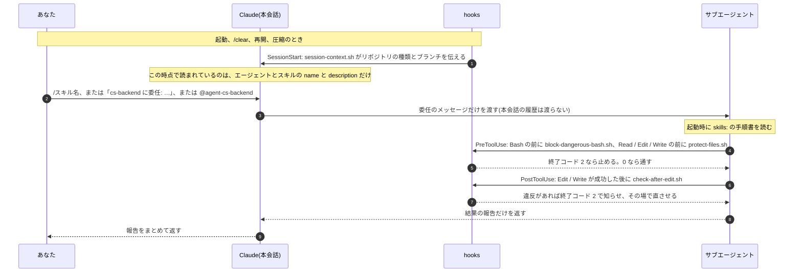

# エージェント・スキル・hooks は、いつ、どう動くか

一言で言うと、エージェントは「頼む」相手、スキルは「開く」手順書、hooks は「勝手に動く」安全装置です。
(根拠: Claude Code 公式ドキュメントの [Subagents](https://code.claude.com/docs/en/sub-agents)、[Skills](https://code.claude.com/docs/en/skills)、[Hooks](https://code.claude.com/docs/en/hooks))

## 1 回の依頼の中での順番

## エージェントの呼び方(4 通り)

| 呼び方 | 書き方 | 確実さ |
|---|---|---|
| Claude に任せる | 普通に頼む。「OCC に項目を足したい」 | Claude が description を見て決める。呼ばれないこともある |
| 名前を出して頼む | `cs-backend に委任: …` | ほぼ呼ばれる |
| @ で指名する | `@agent-cs-backend …` | **必ず**そのエージェントが動く |
| 会話全体をその役にする | `claude --agent cs-backend` | 本会話そのものが cs-backend になる |

エージェントは本会話の履歴、読んだファイル、使ったスキルを受け取りません。受け取るのは、自分の定義、委任のメッセージ、CLAUDE.md、`skills:` の手順書だけです。だから委任のメッセージに「どこで」と「報告の形」を書きます。

## スキルの呼び方(3 通り)

| 呼び方 | 書き方 | 誰が決めるか |
|---|---|---|
| Claude に任せる | 普通に頼む。「ImpEx でマスタを入れたい」 | Claude が description を見て開く |
| 自分で開く | メッセージの**先頭**に `/cs-type-and-impex 引数` | あなた。必ず開く |
| エージェントに持たせる | エージェントの定義の `skills:` | エージェントの起動時に読む |

- 文の途中の `/名前` は「開いてよい」という許可になるだけです。
- `user-invocable: false` は Claude だけが開ける(このキットでは `cs-review-checklist`)。`disable-model-invocation: true` は人だけが開ける。副作用のある `cs-ccv2-release` に付けるのがおすすめです。

## hooks が動くとき(このリポジトリの 4 本)

| イベント | 動くとき | hook | 止められるか |
|---|---|---|---|
| `SessionStart` | 起動、再開、`/clear`、圧縮 | `session-context.sh` | 止めない。標準出力が Claude の文脈に入る |
| `PreToolUse`(Bash) | コマンドを実行する直前 | `block-dangerous-bash.sh` | 止められる(終了コード 2) |
| `PreToolUse`(Read / Edit / Write) | ファイルを読む・書く直前 | `protect-files.sh` | 止められる |
| `PostToolUse`(Edit / Write) | 編集が成功した直後 | `check-after-edit.sh` | もう書いた後なので止めない。終了コード 2 の文が Claude に見え、直させる |

hooks はサブエージェントの中のツール呼び出しでも同じように動きます。あなたが呼ぶことはありません。
