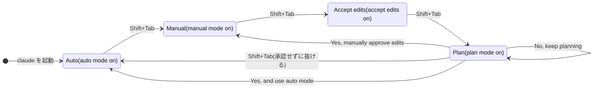

# 課題 1 件を最初から最後まで: あなたの操作手順

流れは「**プランモードで計画を決めて、オートモードで任せて、最後に自分で確かめる**」です。
(根拠: Claude Code 公式ドキュメントの [Permission modes](https://code.claude.com/docs/en/permission-modes)、[Interactive mode](https://code.claude.com/docs/en/interactive-mode))

## モードの見分け方

画面下の表示で分かります。`Shift+Tab` を押すたびに Auto → Manual → Accept edits → Plan → Auto と回ります。

| モード | 画面の表示 | 聞かれずに動くもの |
|---|---|---|
| Manual(`default`) | `⏸ manual mode on` | 読むことだけ |
| Accept edits | `⏵⏵ accept edits on` | 読む、ファイル編集、簡単なコマンド |
| **Plan** | `⏸ plan mode on` | 読む、調べるコマンド。**編集は計画を承認するまで止まる** |
| **Auto** | `⏵⏵ auto mode on` | ほぼ全部。別のモデル(分類器)が実行前に確かめ、危ないものを止める |

- オートモードは Claude Code v2.1.283 以降なら最初からのモードです。会社の設定で切られていると、承認の選択肢が `Yes, auto-accept edits` になります。
- 1 回だけ計画させたいならメッセージの先頭に `/plan`。起動時からなら `claude --permission-mode plan`。



## 手順(課題「送料無料の対象商品だけ、価格の下に『送料無料』を出す」)

### 1. ブランチを切る(あなたが)

```bash
git switch -c feature/JIRA-123-free-shipping
```

### 2. リポジトリの直下で起動する

```bash
claude
```

初回だけ `/agents`、`/hooks`、`/` で、12 人・4 本・スキルが見えるかを確かめます。

### 3. プランモードにする

`Shift+Tab` を押して、画面下を `⏸ plan mode on` にします。

### 4. 課題と、計画に書いてほしいことを渡す

**担当の割り当てを計画に書かせる**のがコツです。書かせないと、承認後に Claude が 1 人で全部やります。

```text
課題 JIRA-123: 送料無料の対象商品だけ、商品詳細ページの価格の下に「送料無料」を出したい。
出発点は playground/storefront/src/app/free-shipping/ です。
受入条件:
- 対象商品の商品詳細ページで、価格のすぐ下に「送料無料」が出る
- 対象外の商品では何も出ない
- 日本語と英語の両方で出る

計画には次を書いてください。
1. 各作業の担当エージェント(.claude/agents の中から)と、使うスキル
2. 順番と、前の担当から次の担当に渡すもの(ファイルのパス)
3. OCC の商品の応答に「送料無料の対象か」が無かった場合の分岐(cs-occ-liaison に依頼書を書かせ、画面は MSW のモックで進める)
4. 変えるファイルの見込みと、確かめ方
5. 最後に cs-auditor に git diff main...HEAD を監査させること

守ること: push、プルリクエスト、デプロイはしないでください。コミットは私がします。
```

最後の行の禁止は、オートモードの分類器にも効きます。会話で言った禁止は、あなたが取り消すまで守られます。

### 5. 計画を読んで直す

| 選択肢 | 意味 |
|---|---|
| `Yes, and use auto mode` | 承認して、オートモードで実行を始める |
| `Yes, manually approve edits` | 承認して、編集を 1 つずつ確認しながら進める |
| `No, keep planning` | 承認しない。続けて直しを書く |

見る所: 担当(画面は cs-frontend、OCC は cs-occ-liaison、監査は cs-auditor)、順番(OCC の確認が先)、分岐(項目が無ければ依頼書で止まる)、確かめ方。
計画を自分で書き換えたいときは `Ctrl+G` でエディタが開きます。

### 6. 承認して任せる

`Yes, and use auto mode` を選びます。画面下が `⏵⏵ auto mode on` になり、計画どおりに担当へ委任が始まります。

### 7. 見ている間

| 起きたこと | あなたの操作 |
|---|---|
| 方向がずれた | `Esc` で止めて言い直す。それまでの作業は残る |
| 前の状態に戻したい | 入力欄が空の状態で `Esc` を 2 回(巻き戻しのメニュー) |
| hooks が止めた | 普通は何もしない。Claude が別のやり方に変える |
| 分類器が止めた | 本当に必要なら `/permissions` の Recently denied で `r`。3 回続けて止まると確認を聞く形に戻る |

### 8. 分岐: OCC に項目が無いとき

cs-occ-liaison が依頼書を書き、画面はモックで先に進みます。Commerce 側は別のセッションで進めます。

```bash
claude --agent cs-backend
```

ここでも `Shift+Tab` でプランモードにして、「依頼書を実装する計画を。手法と理由を 3 行で。本番の更新はしない」と頼み、計画を読んでから承認します。

### 9. 確かめる(あなたが)

```bash
git diff main...HEAD
```

監査の「重要度: 高」が残っていれば「高の 2 件を cs-frontend に直させて。直したらもう一度 @agent-cs-auditor で」と頼みます。

### 10. 仕上げる(あなたが)

コミット、push、プルリクエストは自分で出します。次の課題の前に `/clear` を打ちます(前の会話は消えず、後から再開できます)。
